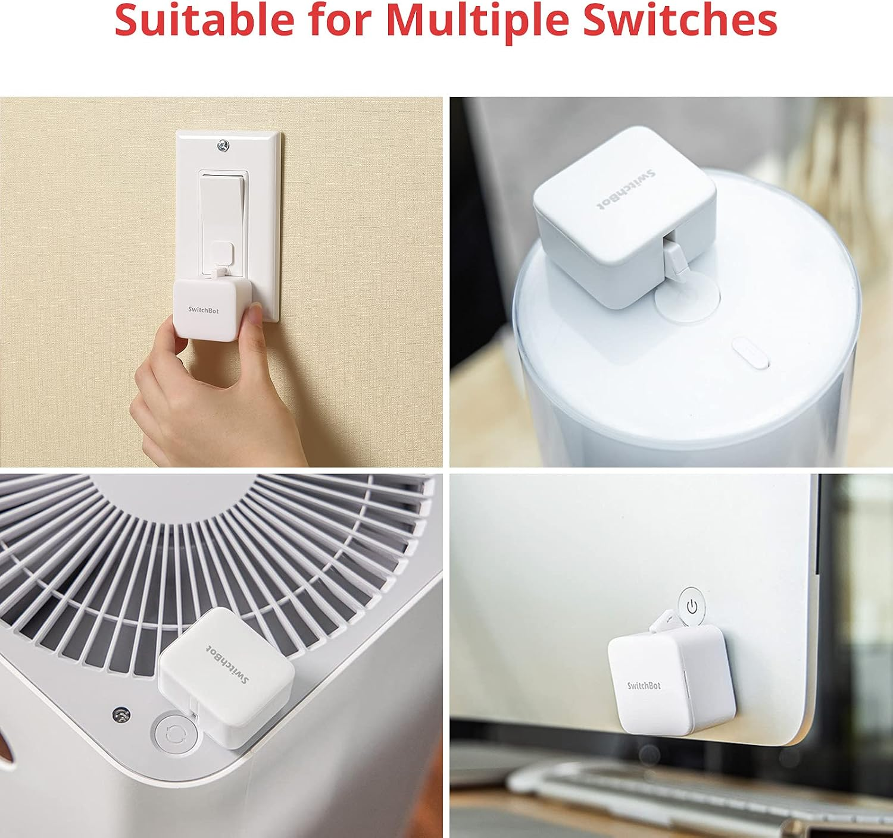
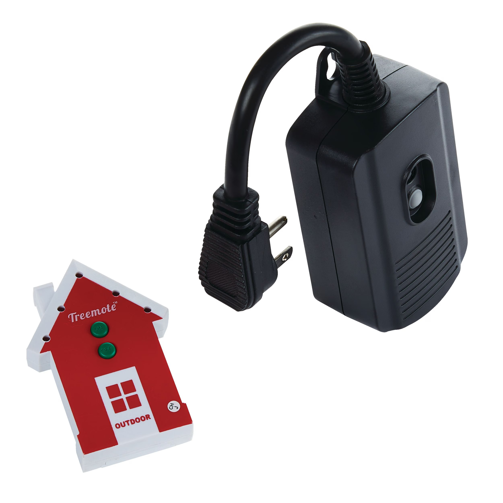
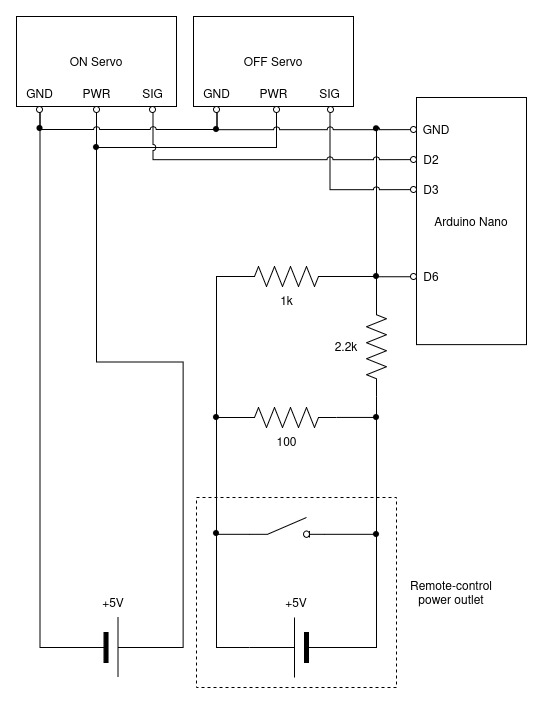
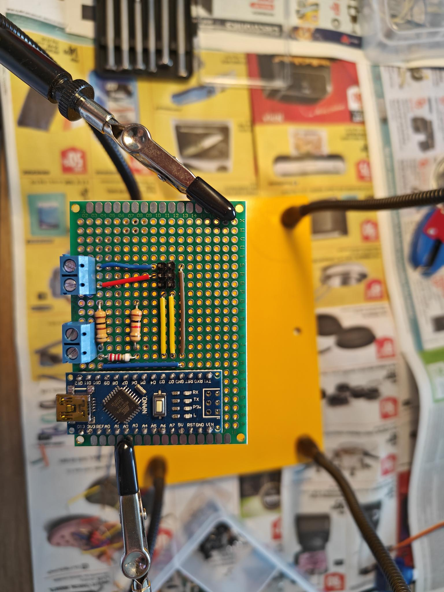
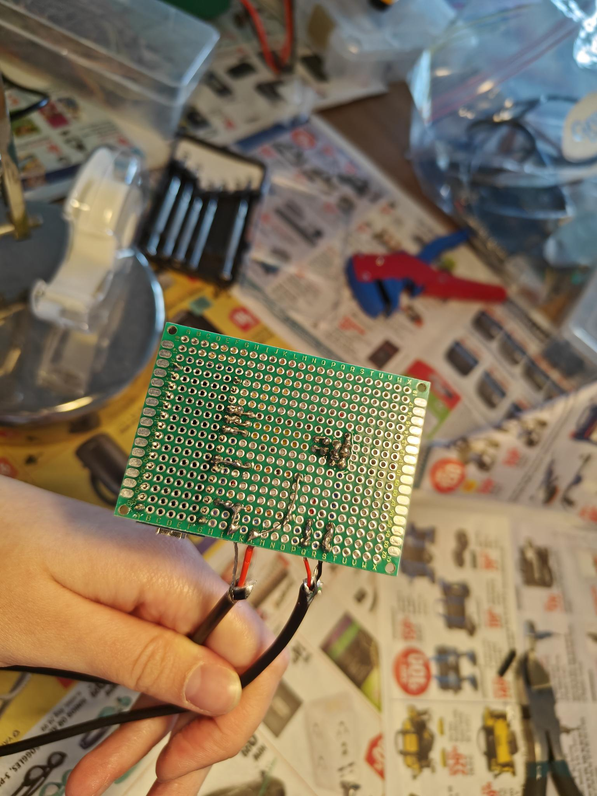
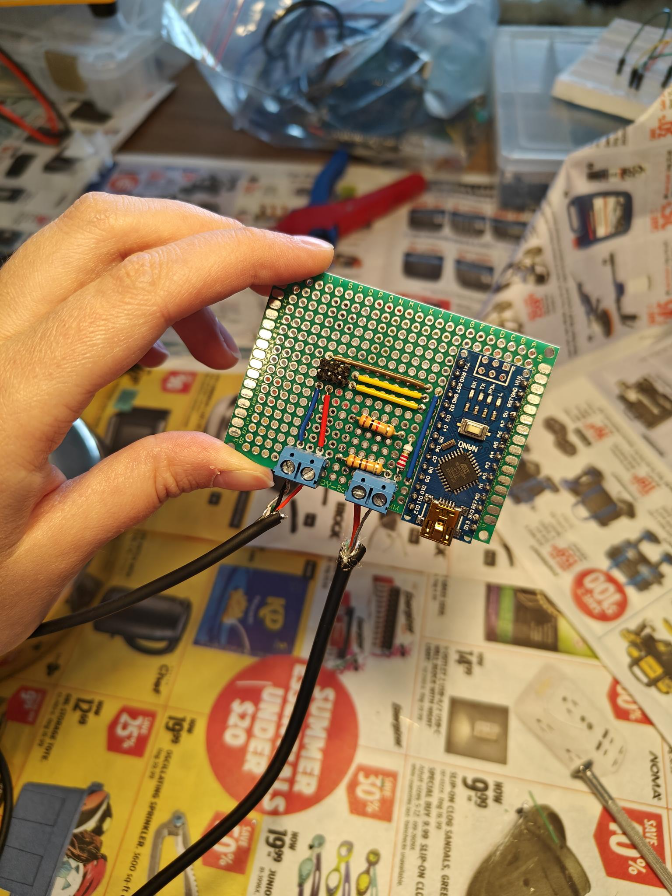



For some reason, the switch that turns on the fan in my bathroom is not *in* the bathroom, but rather inside a closet in the living room. This strange architectural decision has caused an annoyance every time I forget to turn on the fan before a shower. A few weeks ago, I finally had enough and decided to do something about it.  

Since I'm renting, I cannot replace the light switches, so my only option was to find something that could press the switch for me. The best thing I found was this [SwitchBot button pusher](https://www.amazon.com/Switchbot-Switch-Button-Pusher-Bluetooth/dp/B07B7NXV4R?dib=eyJ2IjoiMSJ9.8qpfoyJ8eEg-1oGTJoEfqZBTUMxFWZGM7XGh6UbYx2JUYA4c6r0v10n2NK2xy4SB8bAL8K-TPbuNCI-G_xcEKPHFdmU52X6dfyiIJcyZBw97agiVf3PPdXkIqE0Ej7NLOe5I2Y-6dFFwBhTQ3XUbOtCFLBSUMksKXp3dIlV2UHAA1YMUcqY1pyomVmNrjhn3uhktFyrDQQ8hJQsTE3idgsT1gAvPNm-6QAW-RoJiQ_NN_jAatptmySgEKlz4KRuX2NX4KdygY2V1UkDfzOK9HRukrPlXfSu41srFswU1g8Q.GA0WxEAS1TLp5C1M2cl_lKjkdRcbcYAVx1asXNJrb68&dib_tag=se&keywords=Remote%2BButton%2BPusher&qid=1792285672&sr=8-4&th=1). 


*SwitchBot button pusher*

It's a small device that extends a plastic "finger" to press a button. It can be attached to any surface, and is controlled remotely via Bluetooth. I was ready to order one, but I just couldn't get over the $40 price tag for something meant to solve a minor inconvenience. Also, I refuse to [download another app](https://www.forbes.com/sites/johnkoetsier/2021/02/15/91-of-us-hate-being-forced-to-install-apps-to-do-business-costing-brands-billions/).

I wanted a better solution: something that is inexpensive, doesn't require Wi-Fi or Bluetooth, and doesn't damage the walls or the switch, but I couldn't find an existing product that fit all the criteria. That's when I realized: I can just DIY it, essentially for free. I have several electronic kits left over from university labs and, most importantly, I have the secret ingredient: a radio-frequency (RF) remote-control outlet. 

My idea was simple: put a servo motor on either end of the switch such that when the arms move they press the switch. Use an Arduino to actuate the motors when the voltage changes on one of its input pins. Control this voltage with the remote-control outlet. 

To my own surprise it actually worked, and in this post I will explain how I did it.

## Materials


*Treemote remote-control outlet (not sponsored)*

Electronics used:

- Remote-cotrol outlet. Mine is from [Treemote](https://treemote.com/) and it's intended for controlling outdoor Christmas lights.
- Arduino Nano. Any other similar microcontroller would work too.
- Two [SG90 micro servo motors](https://www.amazon.ca/-/fr/micro-servos-h%C3%A9licopt%C3%A8re-voiture-bateau/dp/B0BJQ2QTHG?source=ps-sl-shoppingads-lpcontext&psc=1&smid=A2QTZX14X1D97I). They are tiny, but have more than enough torque to flip a typical rocker switch. 
- Phone charger
- Resistors
- Breadboard
- Perfboard

Tools used:

- Multimeter
- Soldering iron

## Circuit

I designed a simple circuit consisting of two parts: the trigger pin and the servo motors.



### Trigger Pin

I plugged an old phone charger into the Treemote outlet and cut off the end of the USB cable. Using a multimeter, I measured 5V between the power and ground wires when the outlet was powered on, as expected. However, when I turned off the outlet, there was a nearly 20 second delay before the voltage fell back to zero. The reason was that I had an open circuit with no load to drain the capacitors in the adapter. My solution was to put a 100 \(\Omega\) resistor between the terminals to generate a high current which discharged the capacitors quickly. This reduced the delay to around one second. 

The charger I was using is a USB Power Delivery charger that can negotiate higher voltages (9V and 12V). I wasn't connecting it to anything that could negotiate voltage so it operated at the baseline 5V, but because it was *capable* of outputting a higher voltage, I became worried that a glitch in its controller could cause the voltage to jump. 

Looking back, this fear was completely unwarranted because USB-PD chargers will only output a higher voltage after a series of [handshakes](https://www.macnica.co.jp/en/business/semiconductor/articles/parade/149915/) with the load device. Still, I added a voltage divider to reduce the charger's output voltage from 5V to around 3.33V. Admittedly, this is not an effective solution because for the maximum input of 12V, the divider would output over 8V, which is too high. The proper solution would have been be to use a voltage regulator, or simply a basic 5V-output-only charger. I didn't have either of those on hand, so I just kept the voltage divider.

### Servos

The servo circuit is much simpler. The motors are powered by a constant 5V power source (another phone charger) and their signal pins are connected to the Arduino digital output pins.

## Arduino Code

Here's the Arduino code I used to control the servos. If the trigger pin is `HIGH`, the `ON` servo moves, and if the pin is `LOW`, the `OFF` servo moves. I limited the minimum and maximum angles to be just inside the servos' maximum range of 180\(\degree\), because one of the motors was "twitching" when moved to exactly 0\(\degree\) or 180\(\degree\).  

```c
#include <Servo.h>

#define TRIGGER_INPUT_PIN 6
#define ON_SERVO_PIN   2
#define OFF_SERVO_PIN   3
#define MIN_ANGLE 10
#define MAX_ANGLE 170

Servo on_servo;
Servo off_servo;

bool switchOn = false;

void setup() {
    pinMode(TRIGGER_INPUT_PIN, INPUT);
    Serial.begin(9600);

    on_servo.attach(ON_SERVO_PIN);
    off_servo.attach(OFF_SERVO_PIN);
}

void loop() {
    int value = digitalRead(TRIGGER_INPUT_PIN);

    if (value == HIGH && !switchOn)
    {
        on_servo.write(MIN_ANGLE);
        delay(1000);
        on_servo.write(MAX_ANGLE);
        delay(500);

        switchOn = true;
    }
    else if (value == LOW && switchOn)
    {
        off_servo.write(MAX_ANGLE);
        delay(1000);
        off_servo.write(MIN_ANGLE);
        delay(500);

        switchOn = false;
    }

    delay(100);
}
```

## Assembly

<video controls width="640" height="360">
  <source src="breadboard.mp4" type="video/mp4">
  Your browser does not support the video tag. Please update your browser or [download the video](breadboard.mp4).
</video>

*Breadboard prototype*

I first prototyped the circuit on a breadboard and then soldered the components on a perfboard.


*Perfboard layout*



*Soldered circuit*

## Final Result

Once the circuit was soldered, all I had to do was mount it on the wall. While I initially set out to complete this project using only things I already own, I did have to buy a pack of Command hook strips to secure the RF outlet and the servos. 

<video controls width="640" height="360">
  <source src="demo.mp4" type="video/mp4">
  Your browser does not support the video tag. Please update your browser or [download the video](demo.mp4).
</video>  

*Servos are mounted to the light switch frame and toggle it off and on*

I put the RF remote in the bathroom and now use it to turn on the fan. The seutp has been working reliably for weeks now, and I am very pleased with the result.

Could I have just purchased one of those Fingerbots and saved myself several hours of work on the weekend? Maybe. But nothing compares to the joy of a DIY that actually works!